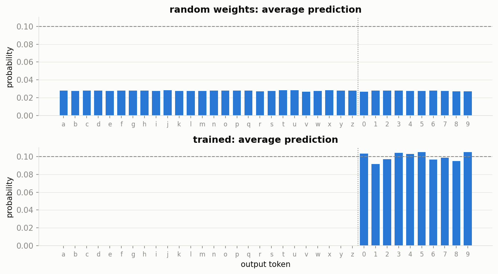
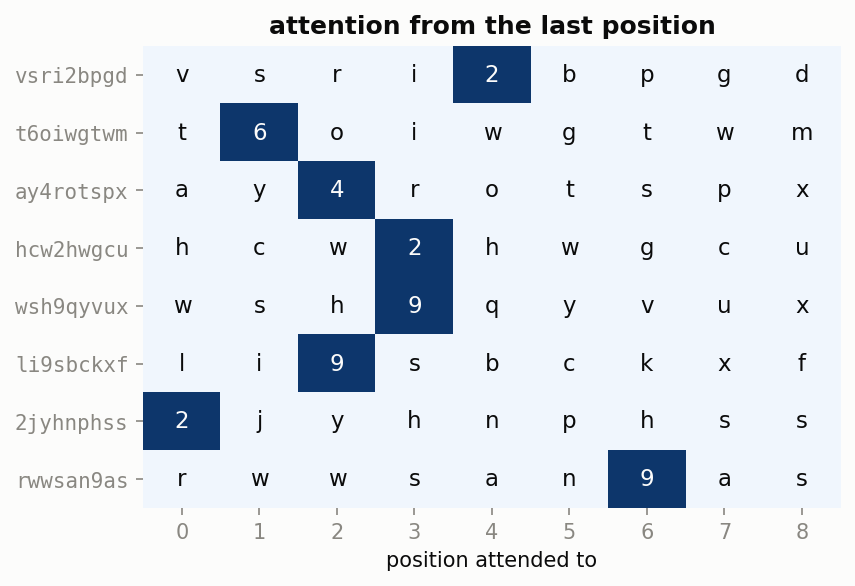
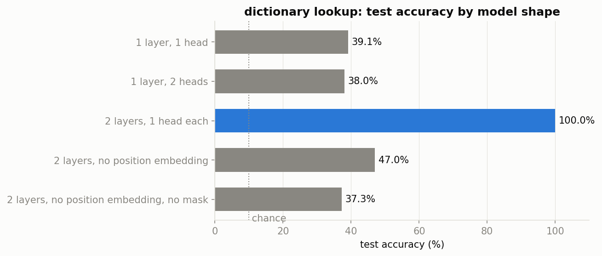
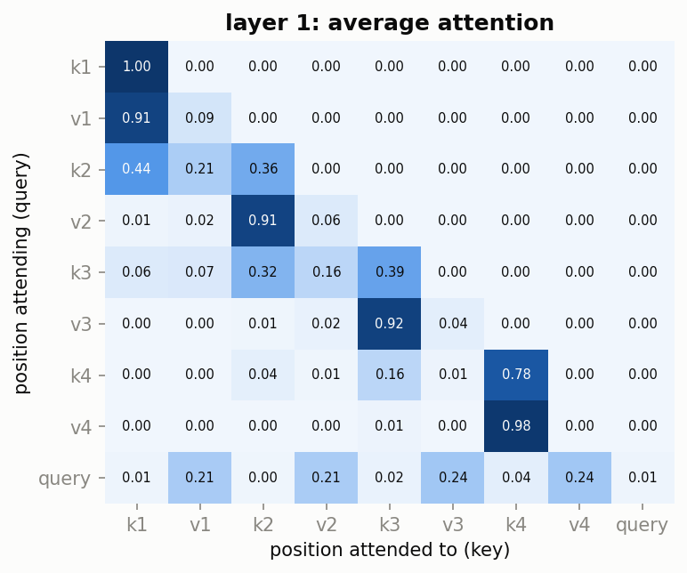
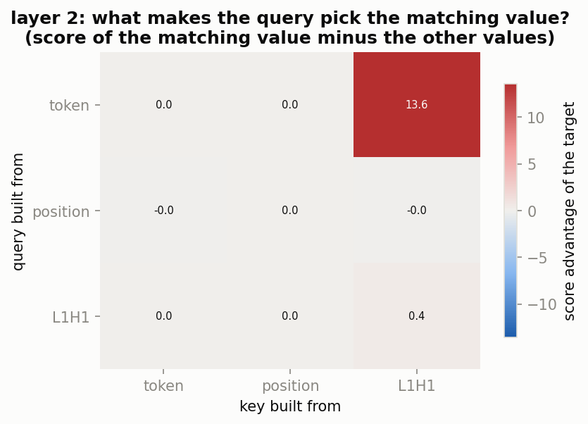
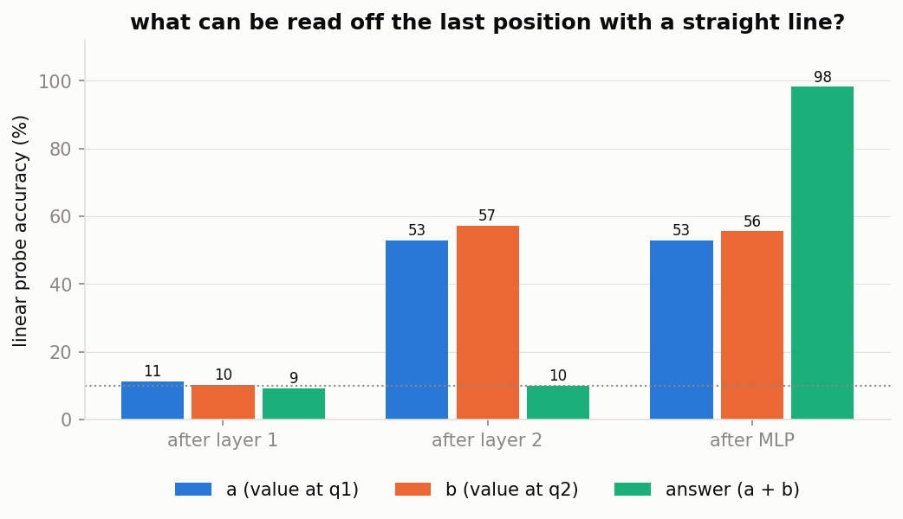
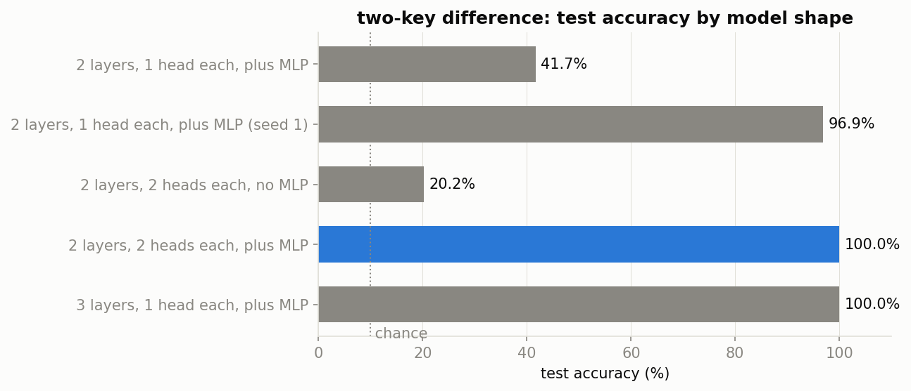
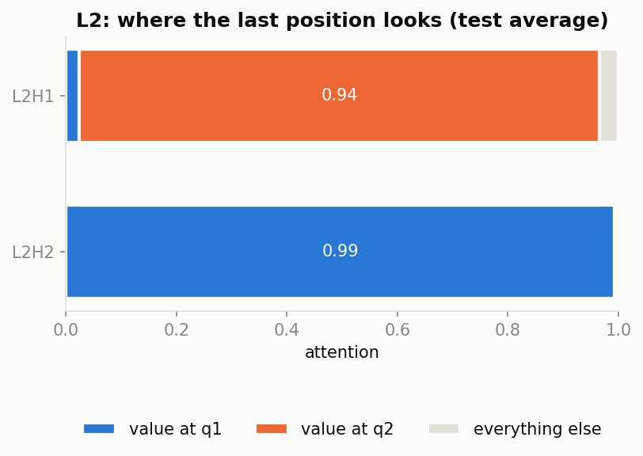

# Tiny transformer interpretability demos

Small transformers trained on toy tasks whose solutions can be read straight off the weights. Each task needs one more piece of the transformer than the one before, and the question throughout is "what can this component write to the residual stream?" The teaching outline is in [tutorial.md](tutorial.md).

| task | input → output | smallest model that solves it | script |
|---|---|---|---|
| 0. hidden digit, no layers | `qwdk7mzpa → 7` | none: embed → unembed stays at chance | `task0.py` |
| 1. hidden digit | `qwdk7mzpa → 7` | 1 layer, 1 head | `task1.py` |
| 2. dictionary lookup | `a2f5c9d3 f → 5` | 2 layers, 1 head each, plus position embeddings | `task2.py` |
| 3. two-key sum | `a2f5c9d3 fc → 4` | 2 layers, 1 head each, plus an MLP | `task3.py` |
| 4. two-key difference | `a2f5c9d3 fc → 6` | 2 layers with 2 heads each plus an MLP (or 3 layers with 1 head each) | `task4.py` |

The vocabulary is a–z and 0–9, and the model outputs one token at the last position. There's no layernorm, no biases and no output projection: each head's V writes straight into the residual stream.

## 0. No layers: nothing moves between positions

The model only sees the last token, which is always a letter. So the best it can do is "some digit, evenly", which is about 10%.



## 1. One head finds the digit and copies it

The head finds the digit by what it is, not where it is (no position embedding needed). It puts 99.7% of its attention on the digit, and the model gets 100%.



## 2. Dictionary lookup needs two layers

A single layer can't do it, however many heads it has, because "comes after f" isn't stored at the digit's own position.



Layer 1 looks one position back, using the position embeddings, and writes each key into the value token after it:



Layer 2 then matches the query against what layer 1 wrote. 13.6 of the matching value's 14.0-point score advantage comes from one product, the query token against the L1H1 write:



## 3. Two-key sum needs an MLP

Attention can carry both digits to the last position, but it can't combine them into a new digit. Without an MLP the model stalls at 26–30%. With one it reaches 97–98%. Linear probes show the answer only becomes readable after the MLP:



## 4. Two-key difference needs two heads (or a third layer)

Order matters now, so task 3's 50/50 blend of both values isn't enough. With one head per layer, the result depends on the seed. In 5 of 9 seeds the model fetches only one value and stalls around 42%. The other 4 learn a lopsided 1/3–2/3 blend that the MLP can untangle, reaching 89–97%. With two heads per layer it gets 100% on 6 of 6 seeds.



With two heads in layer 2, each head fetches one value:



Heads do lookups side by side, and layers do them one after another.

## Running

```
python task0.py   # ... task4.py; each writes plots/task<N>/ and data/task<N>/ (the CSVs behind every plot)
python infer.py checkpoints/task2.safetensors a2f5c9d3f
```

Side experiments that aren't part of the tutorial: `task0_tied.py` (task 0 with tied embeddings), `frozen_mlp.py` (task 2 with an untrained MLP), and `task4_gdn.py` / `task4_gdn_torch.py` (task 4 with gated DeltaNet in place of attention).
